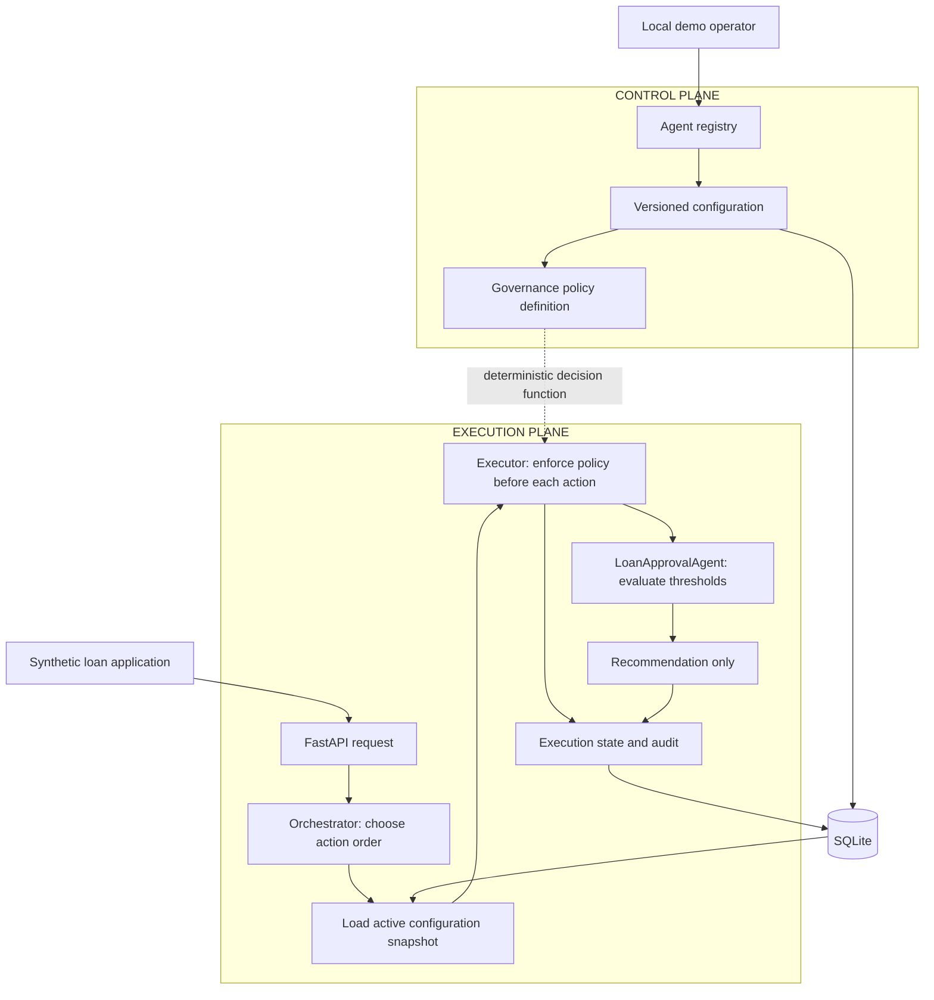

# Control Plane vs. Execution Plane

A small, runnable banking loan recommendation demo. One FastAPI application contains two logically separate planes, backed by SQLite. A deterministic Python agent evaluates synthetic applications; **no LLM, API key, external service, loan approval or payment system is involved**.

## Run locally

Python 3.11+ is required (verified with Python 3.12). From `agent-control-execution-demo/`, install once:

```bash
python -m venv .venv
source .venv/bin/activate
python -m pip install -r requirements.txt
```

On Windows, activate using `.venv\Scripts\activate`.

Run all four scenarios with one command:

```bash
python demo.py
```

The demonstration uses the real FastAPI routes through TestClient and a fresh temporary SQLite database. It asserts each expected result, prints the outcomes and deletes its own temporary data when finished. It can be repeated without cleanup or a running server.

To explore the API instead, start it with one command:

```bash
python main.py
```

API: http://127.0.0.1:8000 · Swagger: http://127.0.0.1:8000/docs

The API uses `demo.db` beside `main.py`; state survives restarts. Set `DEMO_DATABASE` to another file path if desired. The default server binds only to localhost. Stop with Ctrl+C.

Run tests:

```bash
python -m pytest -q
```

## 1. What is the control plane?

The control plane is the management side: it defines **which agent exists and what it may do**. Here it registers a known `LoanApprovalAgent`, stores its capabilities, creates configuration versions and selects the active version. It does not evaluate loan applications.

## 2. What is the execution plane?

The execution plane is the work side: it receives a loan application, loads the active configuration, enforces governance, runs the agent and records a recommendation. It cannot change configuration through the agent interface.

| Question | Control plane | Execution plane |
|---|---|---|
| Main responsibility | Define and govern | Perform approved kinds of work |
| Input | Registration, configuration and policy changes | Loan application or action attempt |
| Main modules | `registry.py`, `configuration.py`, `governance.py` | `orchestrator.py`, `executor.py`, `loan_agent.py` |
| Stored state | Agent metadata and immutable configuration versions | Configuration snapshot, application, result and audit |
| Example | Increase minimum score from 700 to 800 | Evaluate the next application using 800 |
| Authority | Change the rules | Follow the selected rules |

## 3. Why separate them?

A business policy can change without editing agent code. Operational work uses a traceable configuration version, and the agent cannot grant itself more authority. These are logical boundaries in a single application; separate infrastructure is unnecessary for this lesson.



## 4. How does registration work?

`POST /control/agents` stores the agent ID, name, implementation version, capabilities and initial configuration in one transaction. Duplicate IDs return 409. The demo registers metadata for one built-in Python implementation; it does not download or execute arbitrary agent code. Registration's top-level `version` labels the implementation; nested `configuration.version` labels the changeable rules.

## 5. How does configuration affect execution?

The agent compares the application's credit score and loan amount with the configured limits. Score equal to the minimum and amount equal to the maximum pass. Lower scores or larger amounts produce a REJECT recommendation. Monetary values use decimal arithmetic with at most two decimal places.

Every execution loads the active configuration at its transaction boundary. It saves the version and exact configuration snapshot with its result. Updating configuration affects subsequent executions; past results retain their original evidence.

## 6. How does governance prevent unauthorized actions?

The executor checks all three conditions **before each action**:

1. The active configuration enables the agent.
2. The implementation and registered capabilities support the action.
3. The active configuration permits that action.

The implementation only supports `evaluate` and `recommend`. `disburse_loan` and `approve_loan` are denied. Configuration cannot grant unsupported actions, and a policy can narrow the registered capability set. Each ALLOW or DENY is audited. Disabling or removing `recommend` therefore blocks publication even if `evaluate` was permitted.

The loan agent receives application data and numeric thresholds. It receives no configuration management, database or tool handles. Its structured output contains only a recommendation and reason. The orchestrator owns the stored status; an agent output that adds a final approval status fails validation.

This is an application boundary for trusted Python code, not a sandbox for hostile code running in the same process.

## 7. Orchestration versus execution

The **orchestrator** selects the sequence: load active rules → evaluate → recommend → save result. The **executor** performs each selected action only after a policy decision. The **agent** computes the recommendation from thresholds. Keeping these jobs separate makes it clear where planning ends and enforcement starts.

The `/actions` endpoint also permits an `evaluate`-only task, which still passes governance and records EVALUATED. Requesting `recommend` always includes governed evaluation first; it cannot skip that prerequisite.

## 8. How does versioning work?

Configuration updates append an immutable version, then atomically move the active pointer. Use increasing numeric `major.minor` versions, such as `1.0`, `1.1`, `2.0`. `1.10` is newer than `1.9`. Old versions cannot be overwritten or reactivated by this API.

Each update includes `expected_active_version`; a stale value returns 409 rather than silently overwriting another operator's change. Updates are full replacements, not patches. Historical versions remain readable under `/configurations/{version}`.

## 9. What happens when the agent is disabled?

The next execution is BLOCKED with HTTP 403, without invoking the agent. A denied execution record and DENY audit entry are committed before the HTTP error is returned. Unknown agents return 404 and invalid inputs return 422 before execution begins.

Evaluation failures return 500 with a safe FAILED result and persisted audit evidence. Raw exceptions and financial/customer data are excluded from audit rows. The synthetic application is retained in the local execution database.

**Recommendation is not final approval.** An APPROVE recommendation with `requires_human_approval=true` has status PENDING_HUMAN_APPROVAL. REJECT is still a recommendation, with status RECOMMENDATION_ONLY. Setting the human flag to false also yields RECOMMENDATION_ONLY; it never grants final approval. This intentionally small demo has no final approval or disbursement endpoint. A real authorized human decision process would be a separate capability.

## Walk through all four scenarios with curl

Start `python main.py` first. These commands assume a fresh API database and run from this project directory. If you have already registered the sample ID, use `python demo.py` for an isolated repeat or select a fresh `DEMO_DATABASE` file.

**1. Successful execution: register configuration 1.0 and submit an application.**

```bash
curl -sS -X POST http://127.0.0.1:8000/control/agents \
  -H 'Content-Type: application/json' --data-binary @samples/register.json
curl -sS -X POST http://127.0.0.1:8000/execution/agents/loan-agent-001/applications \
  -H 'Content-Type: application/json' --data-binary @samples/application.json
```

Input:

```json
{"customer_id":"C101","loan_amount":300000,"credit_score":750}
```

Response (execution ID varies):

```json
{
  "execution_id": "<generated UUID>",
  "agent_id": "loan-agent-001",
  "agent_version": "1.0",
  "configuration_version": "1.0",
  "recommendation": "APPROVE",
  "status": "PENDING_HUMAN_APPROVAL",
  "reason": "Credit score and loan amount meet policy requirements"
}
```

**2. Governance restriction: disable with configuration 1.1.**

```bash
curl -sS -X PUT http://127.0.0.1:8000/control/agents/loan-agent-001/configuration \
  -H 'Content-Type: application/json' --data-binary @samples/disable.json
curl -i -X POST http://127.0.0.1:8000/execution/agents/loan-agent-001/applications \
  -H 'Content-Type: application/json' --data-binary @samples/application.json
```

Expect HTTP 403. `detail` contains a persisted BLOCKED result using version `1.1` and the reason “Agent is disabled by the control plane”.

**3. Configuration update: re-enable and raise the minimum score to 800 in version 2.0.**

```bash
curl -sS -X PUT http://127.0.0.1:8000/control/agents/loan-agent-001/configuration \
  -H 'Content-Type: application/json' --data-binary @samples/raise_threshold.json
curl -sS -X POST http://127.0.0.1:8000/execution/agents/loan-agent-001/applications \
  -H 'Content-Type: application/json' --data-binary @samples/application.json
```

The identical application now returns REJECT / RECOMMENDATION_ONLY with configuration version `2.0`: 750 is below the new minimum. The implementation remains version `1.0`.

**4. Unauthorized action: request disbursement.**

```bash
curl -i -X POST http://127.0.0.1:8000/execution/agents/loan-agent-001/actions \
  -H 'Content-Type: application/json' --data-binary @samples/unauthorized_action.json
curl -sS 'http://127.0.0.1:8000/execution/audit?agent_id=loan-agent-001'
```

Expect HTTP 403 / BLOCKED and an audit row with `action=disburse_loan`, `decision=DENY`, and configuration version `2.0`. There is no disbursement implementation to invoke.

Inspect current/historical configuration and execution evidence:

```bash
curl -sS http://127.0.0.1:8000/control/agents
curl -sS http://127.0.0.1:8000/control/agents/loan-agent-001/configuration
curl -sS http://127.0.0.1:8000/control/agents/loan-agent-001/configurations
curl -sS http://127.0.0.1:8000/control/agents/loan-agent-001/configurations/1.0
# Replace EXECUTION_ID with a UUID from an earlier response:
curl -sS http://127.0.0.1:8000/execution/records/EXECUTION_ID
```

## 10. How would this scale in an enterprise?

The logical boundaries can remain the same. Add authenticated administrative roles for configuration changes, authenticated application access, a shared transactional database, configuration release approvals, durable audit retention and bounded worker concurrency. Keep the selected version attached to every execution. Long-running work needs explicit rules for refreshing or rechecking policies before consequential actions.

Here, SQLite serializes short local writes using `BEGIN IMMEDIATE`, so configuration selection, governance, result and audit are consistent. A configuration update waits for an in-progress transaction; there is no mid-execution policy revocation. This is suitable for the lesson, not production throughput.

The demo deliberately omits authentication, tenant isolation, final human decision workflows and tamper-proof audit storage. Its endpoints are for synthetic data on a trusted local machine. No Kubernetes, message broker, microservices or cloud setup is required.

## Project map and verification

`main.py` defines API wiring, `models.py` validates contracts, and `database.py` owns SQLite transactions. The two plane folders contain the small domain modules. `samples/` holds runnable request bodies; `demo.py` exercises all four scenarios.

Tests cover policy restrictions, every rule boundary, configuration history, persistence across restart, concurrent version-update conflicts, safe failures and attempts to claim final approval. See [verification](VERIFICATION.md) for executed checks.
