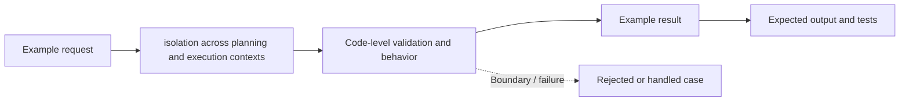

# Task 11: isolation across planning and execution contexts — Architecture

This is a **conceptual diagram of an in-process Python teaching lab**, not a diagram of deployed infrastructure.

## Demonstrated behavior

Pass only a typed plan into an executor and keep planner text outside privileged arguments.

## Production limitations

Logical separation in one process; stronger isolation needs distinct identities, memory spaces, and authenticated execution contracts.

Inspect [main.py](../concept-lab/main.py) and [test_main.py](../concept-lab/test_main.py) to see what the code really enforces.
