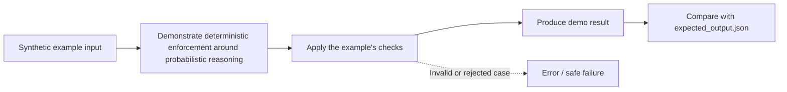

# Task 08: deterministic enforcement around probabilistic reasoning — Architecture

This diagram describes the **logical teaching flow**, not independently deployed services.

## What the demo demonstrates

Treat model output as an untrusted proposal and enforce schema and policy before mutation.

The code and tests are in [concept-lab](../concept-lab/). The architecture above is deliberately conceptual; the actual implementation may be a single in-process Python program.

## What is missing for production

The amount cap is per action. Production also needs cumulative limits, authenticated identity, idempotency, and concurrency control.
