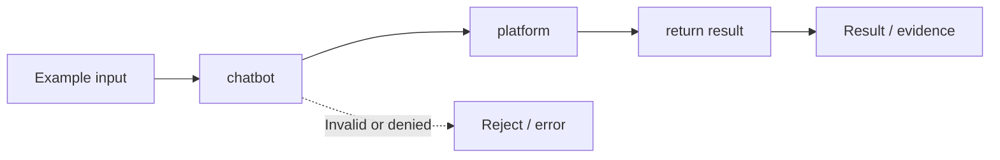

# Task 01 architecture: enterprise agentic ai platform vs chatbot

**Scope:** This is a diagram of the local concept lab, not a diagram of deployed microservices.

## Plain-English walkthrough

Compare a text-only reply with a governed tool action and a recorded result.

The code in [main.py](../concept-lab/main.py) demonstrates this with local synthetic inputs. Follow `demo()` to see how the flow is exercised, and inspect [the tests](../concept-lab/test_main.py) to understand the rejection paths.

## Production considerations

The chatbot and intent are scripted. A production platform needs authenticated callers, durable state, and real tool adapters.

Do not interpret the boxes as independent network services or real model integrations unless separately implemented.
