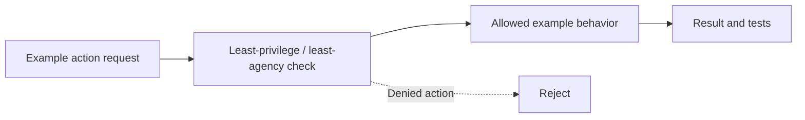

# Task 09: Least privilege and least agency — Architecture

This is a logical view of the local teaching example, not a deployed security architecture.

## Demonstrated behavior

Intersect workload permissions with a request-specific capability and consume its action budget.

## Production limits

A local capability object, not a signed bearer credential; counters need atomic storage across workers.

Read [main.py](../concept-lab/main.py) and [tests](../concept-lab/test_main.py) for the exact implemented checks.
