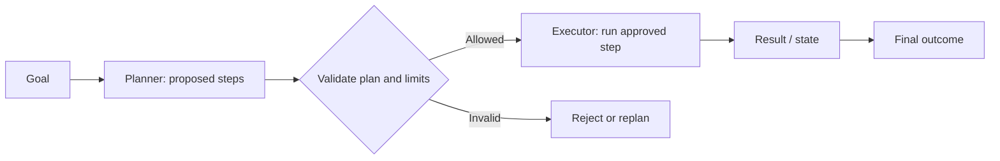

# Architecture: planner executor pattern

This is an **explanatory architecture view** of the engineering concept. Some components are conceptual and are not necessarily separately deployed or implemented by the small offline Python lab. Refer to [main.py](../concept-lab/main.py) and [the tests](../concept-lab/test_main.py) for the precise executable behavior.

## Reading the diagram

The solid arrows show the main logical flow. Decision nodes identify the boundary where an action is approved, denied, filtered, or retried. In a real enterprise deployment, these logical responsibilities may run in separate services, but the sample lab generally uses in-process Python objects.

## Verify the implementation

Run `python3 main.py` and `python3 -m unittest -v` inside `concept-lab/`. The architecture diagram illustrates the concept; the tests and code establish what this branch actually demonstrates.
