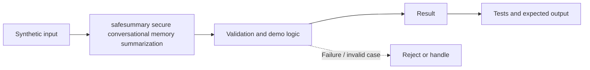

# Task 46: safesummary secure conversational memory summarization — Architecture

**Scope:** This shows a logical in-process concept lab, not a deployed enterprise topology.

## Demonstrated behavior

Build a constrained memory summary from approved fields and revalidate facts against source records.

## Limits

Extractive structured summaries, not general PII detection. Nested sensitive values need classification, and summaries must never serve as authorization evidence.

See [the implementation](../concept-lab/main.py) and [tests](../concept-lab/test_main.py) for exact behavior.
