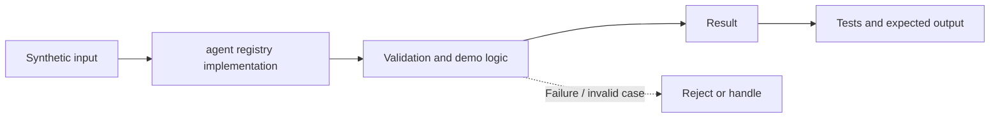

# Task 25: agent registry implementation — Architecture

**Scope:** This shows a logical in-process concept lab, not a deployed enterprise topology.

## Demonstrated behavior

Register immutable capability manifests and discover only active compatible agents.

## Limits

Local registry without signed manifests, health checks, tenant policies, or concurrent registration.

See [the implementation](../concept-lab/main.py) and [tests](../concept-lab/test_main.py) for exact behavior.
