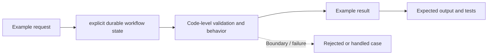

# Task 10: explicit durable workflow state — Architecture

This is a **conceptual diagram of an in-process Python teaching lab**, not a diagram of deployed infrastructure.

## Demonstrated behavior

Persist explicit workflow transitions in SQLite and resume from a reopened connection.

## Production limitations

Workflow state is durable, but this does not make external side effects exactly once; use provider idempotency and reconciliation.

Inspect [main.py](../concept-lab/main.py) and [test_main.py](../concept-lab/test_main.py) to see what the code really enforces.
