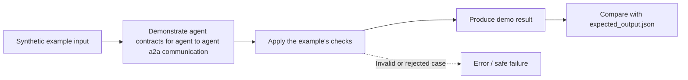

# Task 07: agent contracts for agent to agent a2a communication — Architecture

This diagram describes the **logical teaching flow**, not independently deployed services.

## What the demo demonstrates

Validate a versioned delegation envelope and return a typed error on a malformed task.

The code and tests are in [concept-lab](../concept-lab/). The architecture above is deliberately conceptual; the actual implementation may be a single in-process Python program.

## What is missing for production

An application delegation contract, not an implementation of the A2A protocol or SDK.
