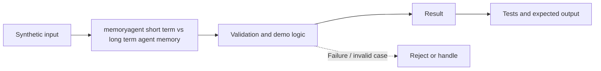

# Task 40: memoryagent short term vs long term agent memory — Architecture

**Scope:** This shows a logical in-process concept lab, not a deployed enterprise topology.

## Demonstrated behavior

Separate expiring session context from explicit, consented long-term preferences.

## Limits

Local memory dictionaries; a production memory service needs deletion, provenance, field validation, access controls, and retention enforcement.

See [the implementation](../concept-lab/main.py) and [tests](../concept-lab/test_main.py) for exact behavior.
