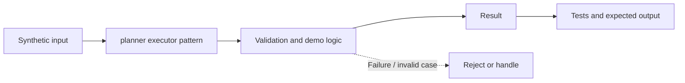

# Task 22: planner executor pattern — Architecture

**Scope:** This shows a logical in-process concept lab, not a deployed enterprise topology.

## Demonstrated behavior

Separate plan construction, whole-plan validation, and execution with approved operations.

## Limits

A deterministic planner stand-in; production needs per-tool schemas, dependency checks, and reauthorization immediately before each effect.

See [the implementation](../concept-lab/main.py) and [tests](../concept-lab/test_main.py) for exact behavior.
