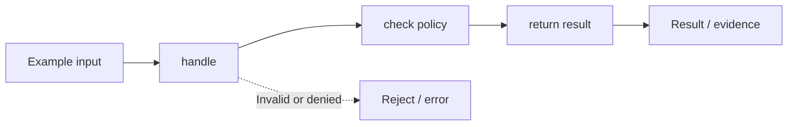

# Task 02 architecture: design an enterprise agentic ai platform from scratch

**Scope:** This is a diagram of the local concept lab, not a diagram of deployed microservices.

## Plain-English walkthrough

Wire request validation, capability routing, a policy boundary, tool execution, and trace evidence.

The code in [main.py](../concept-lab/main.py) demonstrates this with local synthetic inputs. Follow `demo()` to see how the flow is exercised, and inspect [the tests](../concept-lab/test_main.py) to understand the rejection paths.

## Production considerations

A modular in-process reference architecture; it does not deploy independent services or authenticate principals.

Do not interpret the boxes as independent network services or real model integrations unless separately implemented.
