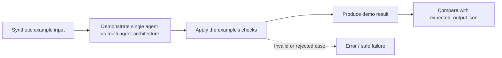

# Task 05: single agent vs multi agent architecture — Architecture

This diagram describes the **logical teaching flow**, not independently deployed services.

## What the demo demonstrates

Compare a single agent with specialist delegation and distinct tool boundaries.

The code and tests are in [concept-lab](../concept-lab/). The architecture above is deliberately conceptual; the actual implementation may be a single in-process Python program.

## What is missing for production

Local specialists simulate separate identities; this does not measure model quality or distributed orchestration overhead.
