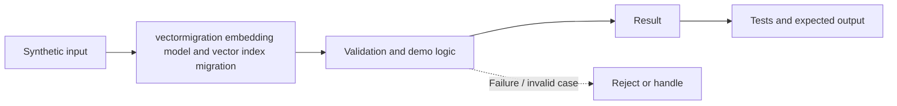

# Task 47: vectormigration embedding model and vector index migration — Architecture

**Scope:** This shows a logical in-process concept lab, not a deployed enterprise topology.

## Demonstrated behavior

Keep embedding spaces separate, shadow-read a replacement index, gate promotion, and support rollback.

## Limits

Small fixed vectors and an externally supplied recall metric; production needs dual writes, backfill reconciliation, measured recall, ACL parity, and deletion propagation.

See [the implementation](../concept-lab/main.py) and [tests](../concept-lab/test_main.py) for exact behavior.
