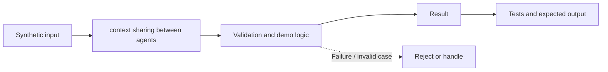

# Task 26: context sharing between agents — Architecture

**Scope:** This shows a logical in-process concept lab, not a deployed enterprise topology.

## Demonstrated behavior

Share only allowlisted task context with tenant validation and defensive copying.

## Limits

Trusted local tenant context. Production must derive tenant identity from verified credentials and classify nested fields.

See [the implementation](../concept-lab/main.py) and [tests](../concept-lab/test_main.py) for exact behavior.
