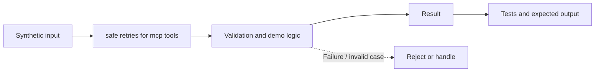

# Task 34: safe retries for mcp tools — Architecture

**Scope:** This shows a logical in-process concept lab, not a deployed enterprise topology.

## Demonstrated behavior

Bind an idempotency key to tenant, workflow, step, and payload; retry a lost reply without repeating the local effect.

## Limits

Single-process local effect simulation. External tools need provider-supported idempotency, durable outbox/reconciliation, and bounded retry with backoff.

See [the implementation](../concept-lab/main.py) and [tests](../concept-lab/test_main.py) for exact behavior.
