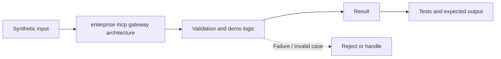

# Task 30: enterprise mcp gateway architecture — Architecture

**Scope:** This shows a logical in-process concept lab, not a deployed enterprise topology.

## Demonstrated behavior

Route registered tool calls through one enforcement boundary with user and workload authorization plus audit.

## Limits

In-process gateway model; production requires MCP transport termination, authenticated callers, schema registries, quotas, and upstream identity binding.

See [the implementation](../concept-lab/main.py) and [tests](../concept-lab/test_main.py) for exact behavior.
