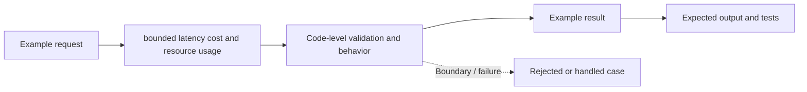

# Task 12: bounded latency cost and resource usage — Architecture

This is a **conceptual diagram of an in-process Python teaching lab**, not a diagram of deployed infrastructure.

## Demonstrated behavior

Reserve cost and step budget before a tool call and bound asynchronous latency with cancellation.

## Production limitations

Cooperative asyncio cancellation and estimated costs; remote work can continue after timeout and needs provider limits and billing reconciliation.

Inspect [main.py](../concept-lab/main.py) and [test_main.py](../concept-lab/test_main.py) to see what the code really enforces.
