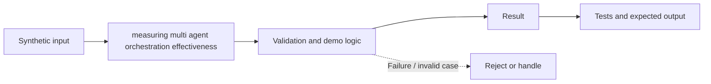

# Task 27: measuring multi agent orchestration effectiveness — Architecture

**Scope:** This shows a logical in-process concept lab, not a deployed enterprise topology.

## Demonstrated behavior

Compute task success, latency percentile, cost per success, and delegation overhead from execution records.

## Limits

Synthetic records illustrate metric definitions; compare architectures on the same held-out workload and report confidence intervals.

See [the implementation](../concept-lab/main.py) and [tests](../concept-lab/test_main.py) for exact behavior.
