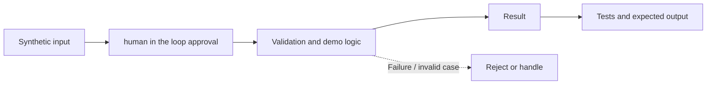

# Task 24: human in the loop approval — Architecture

**Scope:** This shows a logical in-process concept lab, not a deployed enterprise topology.

## Demonstrated behavior

Persist a pending action, approve its exact payload, and consume the approval once inside a transaction.

## Limits

SQLite in-memory approval queue; reviewer authentication and crash-safe dispatch to an external provider remain production work.

See [the implementation](../concept-lab/main.py) and [tests](../concept-lab/test_main.py) for exact behavior.
