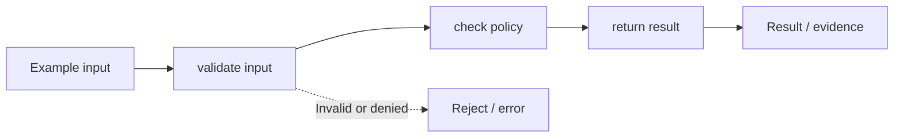

# Task 03 architecture: control plane vs execution plane

**Scope:** This is a diagram of the local concept lab, not a diagram of deployed microservices.

## Plain-English walkthrough

Publish immutable configuration versions while checking live revocation at execution time.

The code in [main.py](../concept-lab/main.py) demonstrates this with local synthetic inputs. Follow `demo()` to see how the flow is exercised, and inspect [the tests](../concept-lab/test_main.py) to understand the rejection paths.

## Production considerations

In-memory configuration distribution; production requires authenticated publication, durable versions, and revocation availability handling.

Do not interpret the boxes as independent network services or real model integrations unless separately implemented.
