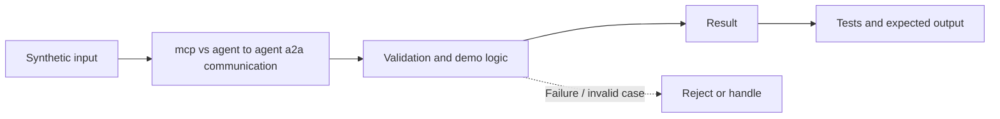

# Task 29: mcp vs agent to agent a2a communication — Architecture

**Scope:** This shows a logical in-process concept lab, not a deployed enterprise topology.

## Demonstrated behavior

Contrast a narrow tool invocation with delegation of a goal and task lifecycle tracking.

## Limits

Conceptual local MCP/A2A comparison, not wire-compatible implementations. Task-ID reuse needs payload binding in a production service.

See [the implementation](../concept-lab/main.py) and [tests](../concept-lab/test_main.py) for exact behavior.
