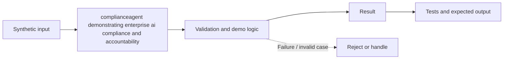

# Task 58: complianceagent demonstrating enterprise ai compliance and accountability — Architecture

**Scope:** This shows a logical in-process concept lab, not a deployed enterprise topology.

## Demonstrated behavior

Export a control-evidence bundle and mark missing evidence explicitly instead of asserting compliance.

## Limits

Evidence completeness is not regulatory compliance. Controls need an agreed framework, independent review, authentic records, retention, and legal interpretation where applicable.

See [the implementation](../concept-lab/main.py) and [tests](../concept-lab/test_main.py) for exact behavior.
