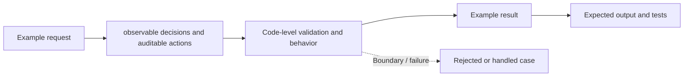

# Task 13: observable decisions and auditable actions — Architecture

This is a **conceptual diagram of an in-process Python teaching lab**, not a diagram of deployed infrastructure.

## Demonstrated behavior

Record correlated proposal, authorization, and action events with sensitive fields omitted.

## Production limitations

Structured local events are not a durable or tamper-evident audit sink; production requires retention, access controls, and export.

Inspect [main.py](../concept-lab/main.py) and [test_main.py](../concept-lab/test_main.py) to see what the code really enforces.
