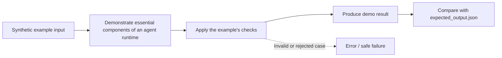

# Task 04: essential components of an agent runtime — Architecture

This diagram describes the **logical teaching flow**, not independently deployed services.

## What the demo demonstrates

Drive a bounded model/tool loop with memory, policy checks, state transitions, and events.

The code and tests are in [concept-lab](../concept-lab/). The architecture above is deliberately conceptual; the actual implementation may be a single in-process Python program.

## What is missing for production

The injected model is deterministic. Real inference, durable checkpoints, cancellation, and transport are extension points.
