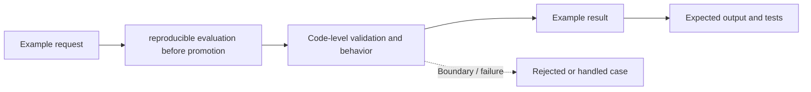

# Task 14: reproducible evaluation before promotion — Architecture

This is a **conceptual diagram of an in-process Python teaching lab**, not a diagram of deployed infrastructure.

## Demonstrated behavior

Run a fixed golden dataset and block promotion on a safety regression even when aggregate accuracy is high.

## Production limitations

Two illustrative cases, not sufficient release coverage. Add held-out domain, adversarial, latency, cost, and subgroup evaluations.

Inspect [main.py](../concept-lab/main.py) and [test_main.py](../concept-lab/test_main.py) to see what the code really enforces.
