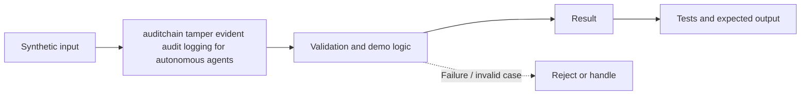

# Task 54: auditchain tamper evident audit logging for autonomous agents — Architecture

**Scope:** This shows a logical in-process concept lab, not a deployed enterprise topology.

## Demonstrated behavior

Chain audit events with keyed hashes and verify against an independently retained terminal checkpoint.

## Limits

Key and journal share a process. Tamper evidence needs protected keys and externally anchored checkpoints; it does not prevent deletion, prove event truth, or survive key compromise.

See [the implementation](../concept-lab/main.py) and [tests](../concept-lab/test_main.py) for exact behavior.
