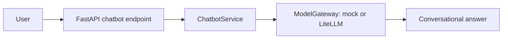
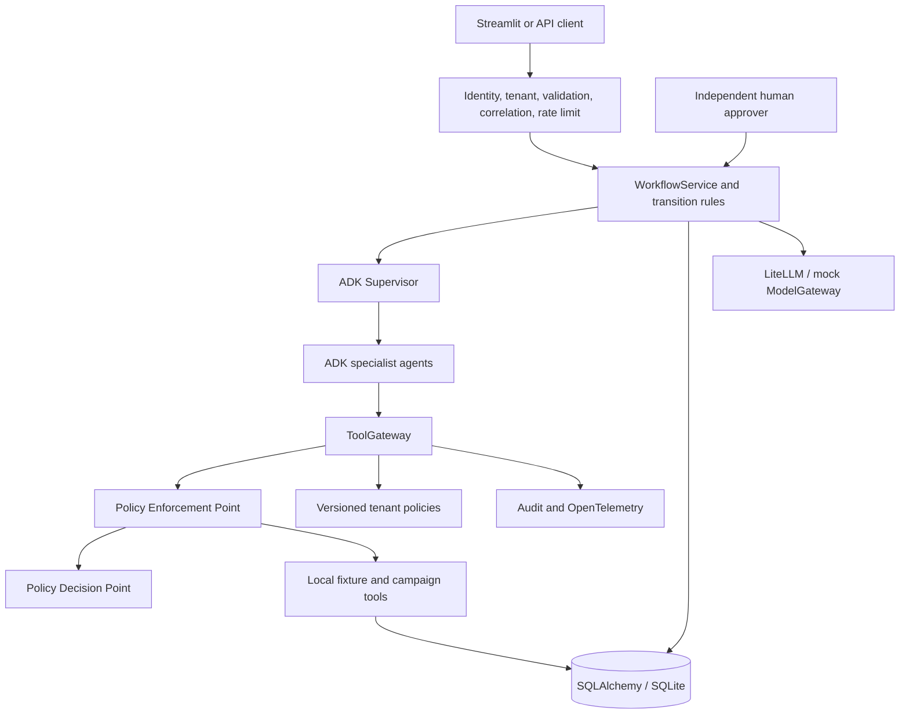
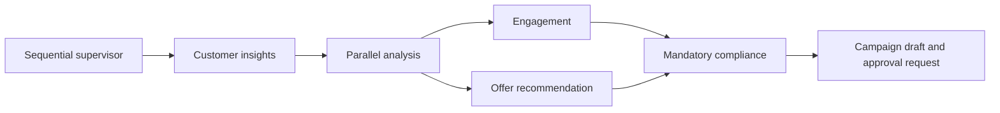
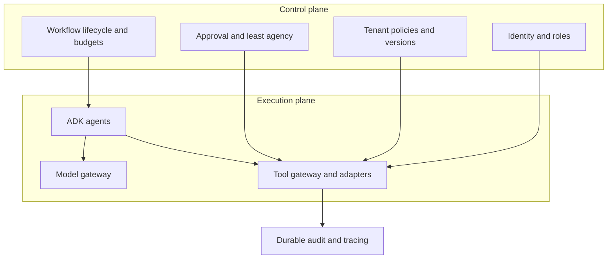
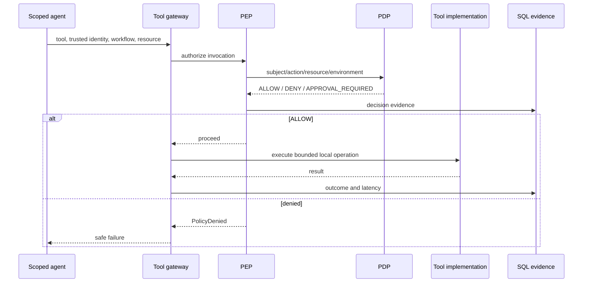

# Architecture and boundaries

The baseline has no reference to repositories or tool gateways. It can only call the model interface.

The enterprise path separates probabilistic interpretation from deterministic authorization and state transitions.

Tool implementations execute only after gateway authorization. Agent methods receive a scoped helper carrying their fixed agent name; public APIs do not let callers supply agent identity. This is a trusted application boundary, not sandboxing against arbitrary Python execution inside the process.

Parallel agents read the same eligibility results and write disjoint state keys. Compliance depends on their completion; the campaign agent validates all contracts before constructing a payload. The ADK runner is per invocation; SQL checkpoints and audit events are the source of durable business truth.

The control plane is a logical boundary in this modular monolith, not a separately deployed service. Policy rules are versioned fixture data while their mandatory enforcement is Python code. The current retrieval service uses lexical search, tenant filtering, current version selection and expiry checks; it can be replaced with a vector store without changing callers. Policy retrieval is not delegated to an LLM. The offer agent augments a model explanation with tenant-scoped policy text and source/version references. This RAG explanation is advisory; offer selection and compliance use deterministic data.

SQL transactions include the simulated side effect and audit/state updates. A unique campaign workflow key prevents duplicate drafts. Replayed completed execution returns the same stored outcome. The original approver's identity is required even on replay. Request keys cannot be reused for a different message.

No network calls occur in mock mode. Dependencies may emit their own deprecation warnings on import. Application telemetry intentionally excludes prompts and raw tool arguments. Production exporters must preserve this redaction boundary.
