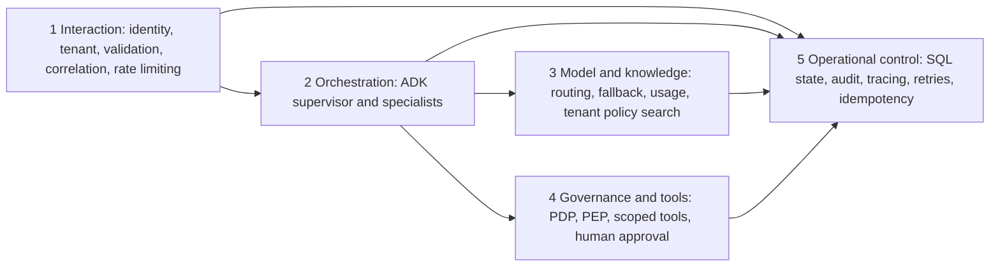

# Five logical capabilities

| Capability | Implemented boundary | Production evolution |
|---|---|---|
| Interaction | FastAPI, fixed demo token lookup, server-derived tenant, Pydantic, process-local rate budget | OIDC gateway, distributed quotas and CSRF/session controls for browser auth |
| Orchestration | ADK SequentialAgent, ParallelAgent and custom typed BaseAgent specialists | Durable queue workers, cancellation signals, resource admission and deadlines |
| Models and knowledge | LiteLLM provider interface, timeout/retries/mock fallback, intent schema, token/cost estimates, lexical policy search | Provider budgets, route health, vector search ACLs, evaluation and policy release process |
| Governance and tools | Tool gateway PEP/PDP, agent allowlists, tenant checks, independent payload-bound expiring approval | Signed service identities, policy engine integration, immutable evidence |
| Operations | SQLite workflow/checkpoints/campaign/audit, local transactional idempotency, OTel spans, bounded retries | PostgreSQL, migrations, outbox, SLOs, central OTLP collector and disaster recovery |

An approver is a human decision maker, not an agent role. Compliance officers inspect same-tenant evidence but cannot start requests or approve campaigns. Managers prepare proposals and can cancel their own nonterminal workflows. Only the independent approver who granted approval may resume that activation.
