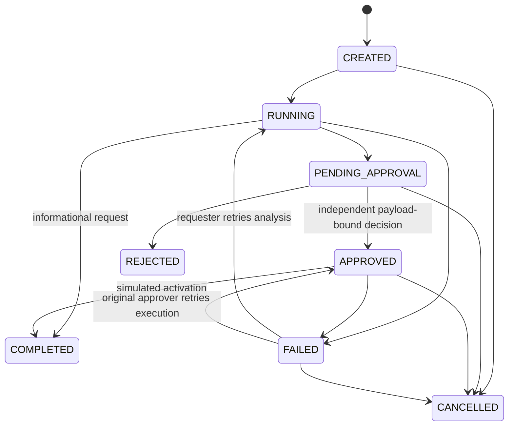
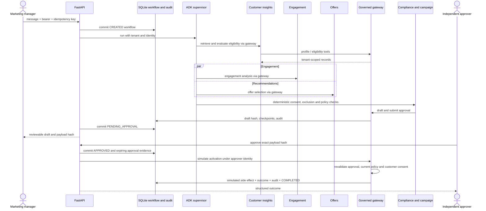

# Workflow and sequence

Terminal workflows do not transition. The FAILED recovery edge depends on whether a valid approval exists. Analysis retries are capped at three workflow attempts; execution shares a total attempt cap of six. Each individual tool operation tries at most three times. Provider calls have a configurable timeout and bounded retry count. Local fixture tools are synchronous bounded operations; any remote replacement must enforce its own I/O deadline.

A process crash during analysis rolls back to the prior committed state (normally CREATED). A handled failure commits safe checkpoints and FAILED. A crash after APPROVED commit resumes with `/execute`; activation and COMPLETED commit atomically. External marketing systems are deliberately absent, so local rollback suffices here. A production remote activation needs idempotency keys and an outbox/reconciliation workflow.
