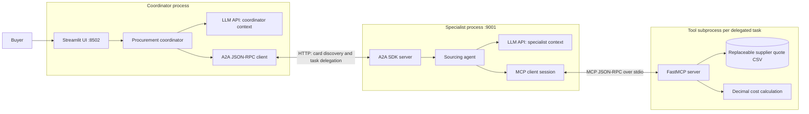

# Two protocols, one buyer decision

The buyer wants an evidence-based purchasing recommendation. A **coordinator agent**
understands the request and delegates research. A **sourcing agent** independently
chooses tools and compares supplier evidence. A **tool server** retrieves facts and
calculates exact costs. Both agents use the configured LLM API; the tool server does not.

## Deployment and ownership



`run.py` starts the two web processes and cleans them up on exit. The sourcing
agent starts a fresh MCP subprocess for each delegated task and closes it after
research. This is a local, read-only POC, not a deployed procurement system.

## A concrete flow the audience can follow

Buyer brief:

> We need 100 business laptops with 16GB RAM and 512GB storage for the US.
> Budget USD 85,000, delivery within 12 days. Prefer EPEAT Gold.
> Compare options and explain compromises.

```mermaid
sequenceDiagram
    actor B as Buyer
    participant U as Streamlit
    participant C as Coordinator
    participant L as LLM API
    participant S as Sourcing A2A server
    participant M as MCP server
    participant D as Quote CSV
    B->>U: Complete buyer brief
    U->>C: recommend(brief)
    C->>S: GET /.well-known/agent-card.json
    S-->>C: Identity, skill descriptions, protocol version, endpoint
    C->>L: Brief + discovered delegation capability
    L-->>C: Tool call with natural-language research request
    C->>S: JSON-RPC message/send (blocking)
    Note over S: SDK creates Task: submitted → working
    S->>M: initialize + initialized notification
    M-->>S: Negotiated version and server capabilities
    S->>M: tools/list
    M-->>S: search_quotes and quote_cost JSON schemas
    S->>L: Delegated request + discovered tool schemas
    L-->>S: Chosen search tool and arguments
    S->>M: tools/call: search_quotes
    M->>D: Read matching rows
    D-->>M: Supplier evidence
    M-->>S: Quote records
    S->>L: Tool result in specialist context
    L-->>S: Chosen cost tool and quantity
    S->>M: tools/call: quote_cost
    M-->>S: Exact subtotal, currency, stock and lead time
    Note over S,L: Bounded tool loop; number and choice of calls vary
    S->>L: Evidence + costs
    L-->>S: Research report with citations and tradeoffs
    S-->>C: Completed Task + report artifact + protocol evidence
    C->>L: Specialist report as tool result
    L-->>C: Buyer-facing recommendation
    C-->>U: Answer and observable protocol trace
    U-->>B: Recommendation, protocol inspector, downloadable evidence
```

The diagram shows one plausible successful run, not a fixed script. The coordinator
can ask a clarifying question instead of delegating. The specialist can search
again, cost several alternatives, or report that the evidence cannot satisfy the
brief. Tool choices and answers come from the LLM. Tool selection is never based
on a Python keyword router.

With the bundled **fictional** dataset, an audience can verify the evidence:
Q-101 has only 90 units, Q-102 has an 18-day lead time, and Q-103 has 120 units,
a 10-day lead time and a USD 83,500 merchandise subtotal for 100 units. This makes
Q-103 an apparently feasible option for that brief, before shipping and taxes.
These are inspectable teaching data, not a programmed answer. Change Q-103's
price or stock in the CSV and rerun the same brief; the retrieved facts and cost
change. The LLM's wording and tool trajectory can also change.

## What each protocol contributes

| Boundary | Protocol | Meaning in this project | What it does not do |
|---|---|---|---|
| Coordinator → sourcing agent | A2A 0.3 JSON-RPC over HTTP | Discover a skill through an Agent Card; submit work; receive task status and artifacts | Expose the specialist's Python functions or internal LLM context |
| Sourcing agent → tool server | MCP, negotiated SDK protocol version, stdio | Initialize a session; discover typed tools; call tools; receive structured/text results | Decide which supplier is best or delegate work to another reasoning agent |
| Each agent → provider | OpenAI-compatible Chat Completions | Interpret requests, choose tool calls, analyze evidence, produce language | Automatically execute a tool or prove its conclusion correct |
| Tool server → CSV | Python file I/O and Decimal | Retrieve the configured dataset and calculate exact costs | Represent a live vendor integration or place an order |

A local function named `delegate_supplier_research` is exposed to the coordinator's
LLM because the provider uses a tool-calling API. Its implementation actually sends
A2A HTTP messages. Similarly, discovered MCP schemas are converted into provider
tool schemas; a selected call actually travels through an MCP ClientSession. Neither
protocol is simulated by renaming an in-process function.

The specialist is an independent agent because it owns its prompt, context, LLM
loop, MCP connection and research result. The coordinator sees a skill and a task
artifact. Replacing the specialist implementation should not require exposing its
internal tools to the coordinator.

## Boundaries and operational limits

- Each agent has at most 8 LLM turns and 12 tool calls per invocation. There is no
  mock fallback and no retry loop. Each provider attempt has a 40-second timeout;
  A2A HTTP has a 300-second timeout. A long research task can time out before its
  turn budget is exhausted. Full deadline propagation/cancellation is future work.
- LLM tool names are allowlisted and arguments are JSON-Schema validated. The tool
  server validates dataset shape, IDs, quantity, positive prices and nonnegative
  stock/lead time. Arithmetic uses Decimal. These are data/integration checks,
  not hardcoded procurement conclusions.
- Quotes are a file snapshot. The system cannot verify vendor claims, shipping
  availability, current stock, tax, foreign exchange or final delivered cost.
  No FX conversion is inferred. Quote dates are included in evidence.
- The source CSV is server-configured, never selected by the LLM. The A2A endpoint
  is pinned to the local specialist; a model or card cannot redirect network calls.
- A2A binds to loopback without authentication. This is suitable for a local
  demonstration only. A remote deployment requires authenticated peers, TLS,
  verified card provenance, tenant isolation, durable task storage, retention
  controls, request budgets and end-to-end cancellation.
- SDK task storage is in-memory. The UI retains only its last result per browser
  session. Each run starts fresh LLM context; A2A conversational task continuation,
  streaming, push notifications and cancellation are outside this POC.
- Treat supplier text and peer artifacts as untrusted evidence. Prompt instructions
  reduce accidental instruction following but are not a prompt-injection security
  guarantee. The tools are read-only and cannot order, reserve stock or run SQL.
- The configured provider receives buyer briefs, delegated requests and retrieved
  quote data. Keep credentials in local `.env`; they are not displayed in traces.
  Trace downloads include business content and are intended for synthetic/demo
  data. Raw provider errors are replaced by safe public failures.
- Protocol trace entries show observable operations, not model chain-of-thought.
  Specialist entries travel back in the artifact and are displayed as a group
  after task completion, not as a global wall-clock timeline or streaming trace.

## Source map

| File | Responsibility |
|---|---|
| `app.py` | Buyer brief, recommendation, architecture and protocol inspector |
| `coordinator.py` | Agent Card discovery, A2A client, coordinator prompt and delegation |
| `specialist_server.py` | Agent Card, A2A SDK task lifecycle, artifact and safe failure |
| `sourcing.py` | Specialist prompt, MCP initialization/discovery/calls |
| `mcp_server.py` | FastMCP server registering quote tools |
| `catalog.py` | Read replaceable supplier data and perform exact cost calculations |
| `llm.py` | Real API tool loop, validation, execution bounds and observable events |
| `run.py` | Launch and stop local services |
| `tests/test_protocols.py` | Actual A2A HTTP + MCP stdio integration with test-only LLM doubles |

Protocol references: [MCP specification](https://modelcontextprotocol.io/specification),
[MCP Python SDK](https://github.com/modelcontextprotocol/python-sdk),
[A2A specification](https://a2a-protocol.org/latest/specification/),
[A2A Python SDK](https://github.com/a2aproject/a2a-python).
This project intentionally uses A2A **0.3** via `a2a-sdk 0.3.x`; it does not claim
compatibility with every later A2A protocol version. MCP negotiates its version
using the installed 1.x SDK; inspect the run trace for the actual negotiated value.
