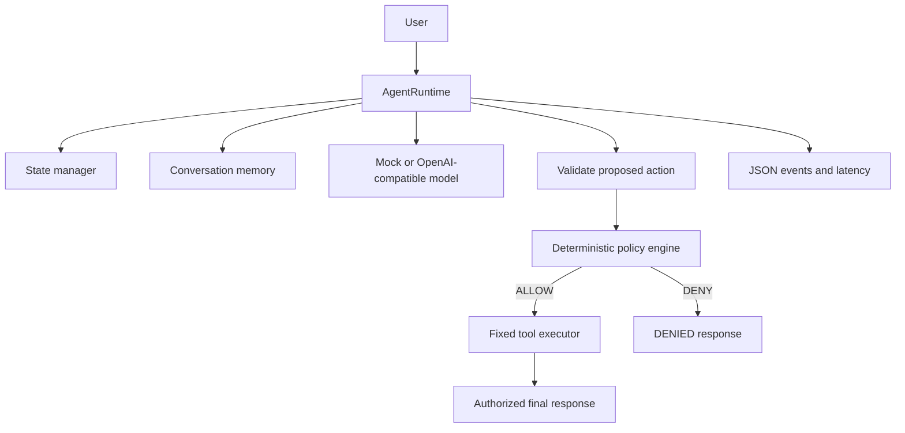
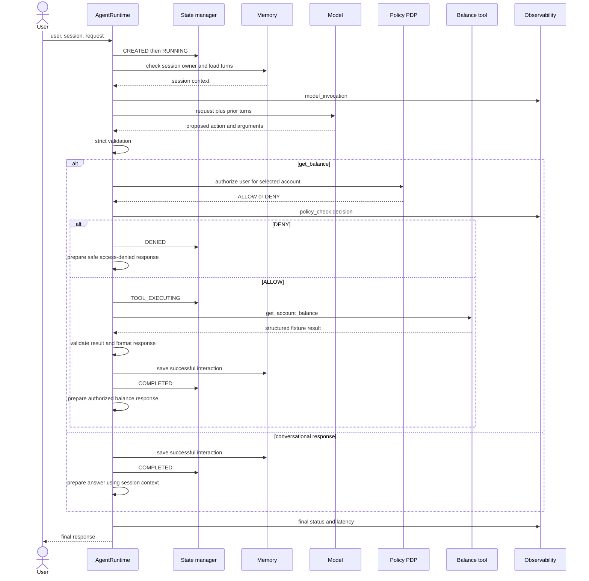

# Minimal Agent Runtime

A bare-minimum, working Python agent runtime for a **Banking Account Balance Assistant**. It coordinates model reasoning, a mock banking tool, conversation memory, execution state, deterministic policy and JSON logs. All accounts and balances are synthetic.

There is no framework, database or external service in the default path. The application uses only Python's standard library. `pytest` is the only test dependency.

## Run

Python 3.11+:

```bash
cd minimal-agent-runtime
python main.py
```

That one command runs all three scenarios with a deterministic mock model and no API key:

- **A — Successful:** `user1` requests ACC123 → ₹50,000.
- **B — Unauthorized:** `user1` requests ACC456 → DENIED, no tool execution.
- **C — Multi-turn:** `user1` asks for ACC123, then asks “What was my previous question?” in the same session → memory supplies the earlier question, without another tool call.

Human-readable scenario output goes to stdout. Structured JSON logs go to stderr. To inspect them separately:

```bash
python main.py > responses.txt 2> events.jsonl
```

The authorized business response intentionally shows the balance. JSON logs omit balances, account IDs, prompts, credentials, conversation content and raw exception messages.

## Test

```bash
python -m venv .venv
source .venv/bin/activate
python -m pip install -r requirements.txt
python -m pytest -q
```

Windows: activate with `.venv\Scripts\activate`. You can also run `pytest` directly from this directory.

## What is an agent runtime?

An agent runtime is the program that turns a request into a controlled execution. It provides the surrounding machinery: load context, call a model, validate its proposal, check permissions, dispatch tools, remember the interaction and report what happened.

An **LLM** suggests what to do. The **runtime** decides whether that suggestion is valid and authorized, and then performs the permitted work. A model response alone is not a tool execution or an authorization decision.

## The six components

| Component | Python file | Simple explanation |
|---|---|---|
| Model invocation | `model.py` | Chooses `get_balance` with an account ID, or a conversational response; includes a deterministic mock and an optional OpenAI-compatible adapter |
| Tool execution | `tools.py` | Retrieves a structured synthetic account balance and validates the returned account, amount and currency |
| Memory | `memory.py` | Stores prior user/assistant turns in a session-keyed dictionary, bound to a trusted caller identity |
| State management | `state.py` | Tracks each request's ID, session, lifecycle, selected tool, result, safe error and latency |
| Policy enforcement | `policy.py` | Answers whether a user can read the selected account, independently of model instructions |
| Observability | `observability.py` | Emits allowlisted JSON events and execution latency, without sensitive content |

`agent.py` contains the single `AgentRuntime` orchestrator. `main.py` demonstrates its lifecycle. These modules are small so you can follow an entire request without a framework.

### Model invocation

A mock model recognizes an account reference and proposes:

```json
{"action":"get_balance","account_id":"ACC123"}
```

A conversational request proposes:

```json
{"action":"respond","response":"Your previous question was: Check ACC123 balance."}
```

The runtime accepts only these exact action/argument shapes. Unknown tools, extra arguments, lists of calls, malformed account IDs and invalid response types fail safely. There is no `eval`, `exec`, arbitrary method dispatch or model-driven loop. At most one tool is invoked per request.

The real model is probabilistic, even with temperature zero. Its proposal still passes the same deterministic validation and authorization checks.

### Tools

A tool is a function that retrieves facts or performs work outside the model's text generation. The model cannot know a current bank balance from language alone, so this demo gives the runtime one fixture-backed tool:

```python
get_account_balance("ACC123")
# {"account_id": "ACC123", "balance": 50000, "currency": "INR"}
```

The runtime maps the allowed action name `get_balance` to that function. The LLM never receives a function handle or executes Python. A result for a different account is rejected before it enters memory or the final response.

### Memory versus workflow state

| Conversation memory | Execution state |
|---|---|
| Keyed by session ID | Keyed by request ID |
| “What did this user ask and what did the assistant answer?” | “What is this particular request doing, and did it succeed?” |
| Prior user/assistant turns become model context | Lifecycle, selected tool, result, error and latency remain operational data |
| Persists between turns in the same runtime instance | Separate record for each turn |
| Enables “What was my previous question?” | Enables “Was the account request denied before the tool ran?” |

Both are ordinary in-memory dictionaries and are lost when the process exits. A session ID is bound to its first caller identity. A different user reusing it is denied before loading history into the model. Denied and failed turns are not added to conversation memory.

### Policy: PDP and PEP

The **Policy Decision Point (PDP)** is `authorize()` in `policy.py`:

- `user1` can read ACC123.
- `user2` can read ACC456.
- Other combinations are denied.

The **Policy Enforcement Point (PEP)** is the check inside `AgentRuntime.run()` immediately before the sensitive tool invocation. The runtime checks the **validated model-selected account**, not just account text in the user's prompt. Asking the model to ignore policy or select another account cannot grant access.

Session ownership is checked before model context is loaded. Account authorization is checked after the model proposes its target, matching the runtime lifecycle. In a real API, authentication must establish `user_id` on the server; this CLI supplies a trusted identity directly. It is not a full authentication system or a sandbox for hostile Python code.

### Observability: logs, metrics and traces

**Logs** describe individual events. **Metrics** aggregate measurements such as failure counts or latency percentiles. **Traces** connect timed operations across a request and potentially across services.

This demo implements **JSON logs and elapsed request latency only**. It does not implement a metrics backend or distributed tracing. `time.perf_counter()` measures elapsed time through success, denial and failure paths.

Example safe log:

```json
{"event":"policy_check","request_id":"<UUID>","state":"RUNNING","decision":"ALLOW","tool":"get_balance"}
```

Events cover request receipt, state changes, memory loading/updating, model invocation/decision, policy decisions, tool start/completion, safe failure and final status/latency. An in-memory event list makes the same evidence easy to inspect in tests.

## Full request lifecycle

1. Receive a user ID, message and optional session ID; generate a fresh request ID.
2. Create execution state and move CREATED → RUNNING.
3. Validate the request, check session ownership and load conversation memory.
4. Invoke the model with the current request and that session's prior turns.
5. Validate the model's exact proposed action and arguments.
6. For `get_balance`, evaluate the deterministic account-access policy.
7. If denied, move to DENIED, emit the decision and return a safe denial. **No tool executes.**
8. If allowed, move to TOOL_EXECUTING, dispatch the one allowed tool and validate its structured result.
9. Build the authorized response, save the interaction in memory and move to COMPLETED.
10. Record final status and elapsed latency, then return a structured result plus response.

A conversational response takes RUNNING → COMPLETED without TOOL_EXECUTING. Invalid model calls, provider errors or tool failures move to FAILED, record a safe error and return a generic response. Raw exceptions are discarded because they can contain secrets or sensitive values.





The sequence diagram summarizes business calls. The implementation records final status/latency in a `finally` block before returning on every path, including failure. Session ownership denial occurs before the model call; malformed actions and tool errors follow FAILED rather than the normal paths shown above.

## Example CLI output

IDs and latency vary; JSON events are interleaved on stderr when you view both streams together.

```text
A — Authorized balance lookup
Lifecycle: CREATED → RUNNING → TOOL_EXECUTING → COMPLETED
Selected tool: get_balance Latency: <measured> ms
Response: The balance of account ACC123 is ₹50,000.

B — Unauthorized account lookup
Lifecycle: CREATED → RUNNING → DENIED
Selected tool: get_balance Latency: <measured> ms
Response: Access denied. You are not authorized to view this account.

C — Conversation, memory follow-up
Lifecycle: CREATED → RUNNING → COMPLETED
Selected tool: None Latency: <measured> ms
Response: Your previous question was: Check ACC123 balance.

Session C memory contains 2 interactions.
```

## Enable a real LLM

The default is always mock mode, even if an API key happens to exist. To opt in to an OpenAI-compatible **Chat Completions** service on Bash:

```bash
export LLM_MODE=openai
export OPENAI_API_KEY='<your-key>'
export OPENAI_BASE_URL='https://api.openai.com/v1'
export OPENAI_MODEL='gpt-4o-mini'
export LLM_TIMEOUT_SECONDS=10
python main.py
```

PowerShell uses `$env:LLM_MODE = 'openai'` and corresponding `$env:` assignments. `.env.example` documents settings; the program does not automatically load `.env` files. Keep actual credentials out of source control.

The adapter uses standard-library `urllib.request`, sends prior session turns as Chat Completions messages and asks for a JSON object using `response_format`. Your endpoint must support that API shape. It makes one provider attempt, uses a configurable socket timeout, reads at most 64 KiB and fails safely on missing credentials, transport errors or invalid output. There is no silent fallback once real mode is selected. Provider calls may incur charges; mock mode makes no network requests.

In real mode, the configured provider receives the user prompt and prior session conversation, including any authorized responses in memory. Real responses may differ from the deterministic CLI examples. Account access remains enforced by Python policy.

## Final directory structure

```text
minimal-agent-runtime/
├── main.py
├── agent.py
├── model.py
├── tools.py
├── memory.py
├── state.py
├── policy.py
├── observability.py
├── requirements.txt
├── .env.example
├── .gitignore
├── README.md
└── tests/
    └── test_agent.py
```

## Verification

Verified with Python 3.12: **35 tests passed**, Ruff lint/format checks passed, and `python main.py` completed all three scenarios using the system Python standard library without credentials. Tests cover success, account/session denial, zero tool calls after denial, invalid model actions, multi-turn memory, state transitions, tool failure, safe JSON logs and the one-tool limit. OpenAI-compatible request construction and error handling are tested with fake HTTP responses; no paid provider was called.

## Interview-ready explanation

“The model proposes an action, but the runtime owns execution. It loads session memory, validates the proposal, checks a deterministic policy, dispatches only an allowlisted tool, updates request state, records safe events and returns a response. Conversation memory explains what was said; execution state explains what happened. Separating model reasoning from authorization keeps an incorrect or manipulated model output from granting tool access.”

## What would change for production?

Add server-verified identity, session expiry and retention limits, concurrent access control, durable state if restart recovery is required, governed secret handling and reviewed data-sharing rules for model context. Replace the fixture tool with an authenticated banking adapter, enforce end-to-end deadlines, and export redacted operational evidence to managed storage. Model validation and the tool-side authorization boundary must remain independent of model reasoning. These are future requirements, not features implemented by this minimal demo.
