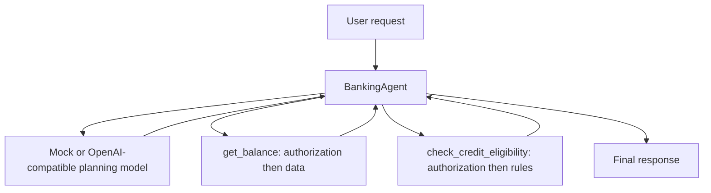
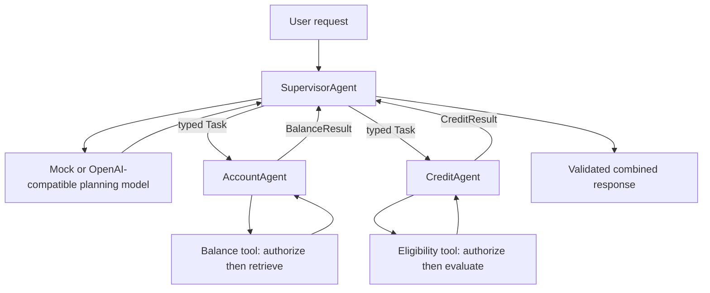

# Single-Agent vs. Multi-Agent Architecture

A minimal Python banking demo that runs **the same request** through a single agent and a supervisor with two specialists:

> Check my account balance for ACC123 and tell me whether I am eligible for a credit card.

Both paths use the same synthetic banking tools, authorization checks, model planning contract and eligibility rules. There are no frameworks, databases, networked agents or deployment infrastructure. The application runs on Python's standard library; pytest is the only test dependency.

## Run

Python 3.11+:

```bash
cd single-vs-multi-agent
python main.py
```

No key or installation is needed to run the default deterministic mock. The CLI prints both successful results, an observed metrics comparison, and a credit-specialist failure demonstration. User-facing output goes to stdout; structured execution logs go to stderr.

Separate the streams if desired:

```bash
python main.py > responses.txt 2> events.jsonl
```

Tests:

```bash
python -m venv .venv
source .venv/bin/activate
python -m pip install -r requirements.txt
python -m pytest -q
```

On Windows, activate with `.venv\Scripts\activate`. `pytest` also works directly from this project directory.

## Business data and rules

| Synthetic field | Value |
|---|---|
| Account | ACC123 |
| Owner | user1 |
| Balance | ₹50,000 |
| Credit score | 760 |
| Monthly income | ₹100,000 |
| Illustrative card rule | Credit score ≥ 700 **and** monthly income ≥ ₹50,000 |

The expected outcome is a ₹50,000 balance and eligibility under these illustrative rules. This is not underwriting advice or a real card approval.

Both tools check the trusted caller's identity against account ownership **before reading the financial record**. This applies to balances and credit data alike. Unknown accounts and unauthorized callers are denied without exposing financial data. The CLI supplies identity directly; production authentication is outside the demo.

## A. One BankingAgent

`BankingAgent` obtains a structured plan, validates it, selects its tools, invokes them and combines their results. The full request and the intermediate results remain in one execution unit.



One agent is usually easier to understand, test and operate. It shares context directly and has no agent-message boundary. As the number of unrelated capabilities grows, however, its responsibilities, tool surface and context can become harder to manage.

## B. Supervisor and specialists

`SupervisorAgent` obtains the same plan and delegates typed tasks to the appropriate specialists using **ordinary Python method calls**. It never directly calls their tools.

| Agent | Responsibility and capability description | Input → output |
|---|---|---|
| SupervisorAgent | Plan, delegate and aggregate validated results | user request → combined outcome |
| AccountAgent | Retrieve an authorized balance; no credit responsibility | `Task(user_id, account_id)` → `BalanceResult` |
| CreditAgent | Evaluate illustrative card eligibility; no balance responsibility | `Task(user_id, account_id)` → `CreditResult` |

Each specialist logs its own execution start and completion/failure. It receives only the scoped task, not the full request or the other specialist's output. The same metrics object carries correlation and counters, not shared business context. The supervisor validates every returned result, including the account it belongs to, before aggregation.



The two specialist branches are logically separate. **This implementation executes them sequentially**, as does the single-agent tool loop. The diagram does not imply parallel execution or separately deployed services.

## Structured planning, not keyword routing

Both architectures consume exactly the same plan shape:

```json
{"account_id":"ACC123","capabilities":["balance","credit"]}
```

The default mock model emits a deterministic plan for this specific combined banking use case. It extracts one synthetic account reference and selects both capabilities. It is a model test double, not a general natural-language interpreter.

The orchestration code does not route by banking keywords. It validates the plan and dispatches through a fixed capability map. A different valid plan can select just `balance` or just `credit`; tests prove this using an opaque request with no banking keywords. The optional real model selects one or both capabilities from the request.

Plans with unknown/duplicate capabilities, invalid accounts or unexpected fields are rejected before tools or specialists are called. Neither architecture executes code or arbitrary tool names supplied by a model. Financial results come from tools, not model text. Result contracts reject incorrect accounts, non-boolean eligibility and unexpected fields.

## Comparison and observed metrics

| Dimension | Single agent | Multi-agent in this demo |
|---|---|---|
| Orchestration | One agent selects and calls tools | Supervisor delegates typed tasks |
| Communication | Internal tool calls | In-process method calls with input/output contracts |
| Scalability | Shared execution unit | Also a shared execution unit; separate scaling would require later extraction |
| Reliability | Fewer component boundaries | More failure and validation boundaries; explicit partial-result handling |
| Context | Request and results shared within the agent | Scoped task context for each specialist |
| Operational overhead | Lower | More agents, contracts and correlated events |
| Latency | Sequential tool calls | Sequential delegation plus tool calls; no claimed speedup |
| Testing | Tool and end-to-end tests | Specialist, contract, delegation and integration tests |

Metrics are measured at runtime:

- `duration_ms`: elapsed wall-clock time from request start through planning, execution, logging and aggregation, using `time.perf_counter()`.
- `model_calls`: actual model-selection invocation attempts, counted before calling the adapter. Invalid output still counts as an invocation.
- `tool_calls`: actual tool invocation attempts, including calls that subsequently fail authorization or execution. Denied calls read no financial data.
- `agent_calls`: entry into the banking agent, supervisor and real specialist implementations.

Successful single-agent execution uses **1 model, 2 tools, 1 agent**. Successful multi-agent execution uses **1 model, 2 tools, 3 agents**. Specialists are deterministic Python agents and do not each call another model.

One observed local mock-mode run produced:

```text
Architecture       Duration ms  Model  Tool  Agent
Single                   0.354      1     2      1
Multi                    0.170      1     2      3
```

These values are a single captured run; `python main.py` recomputes them every time. Tiny timings include logging, warm-up and scheduling noise. They are **not a benchmark**, evidence of a multi-agent performance improvement, or a basis for choosing an architecture. A comparison with real providers would need repeated, controlled measurements and quality evaluation.

## Partial failure and graceful degradation

The CLI's third run constructs `CreditAgent(fail=True)`. That specialist logs its start and fails before invoking the eligibility tool. The supervisor catches the failure at the delegation boundary, records an error with the request's correlation ID, and continues aggregating available results.

```text
SupervisorAgent — PARTIAL
Account ACC123 balance: ₹50,000. Credit card eligibility is unavailable; no eligibility conclusion was made.
Model calls: 1 | Tool calls: 1 | Agent calls: 3
Error: credit / specialist_failed / <same correlation ID>
```

The balance remains available whether the failed credit specialist runs first or second. No eligibility value is invented, and an invalid specialist result is treated as unavailable rather than trusted. The single agent also isolates tool failures in its tool loop; graceful degradation is an implementation choice, not a capability exclusive to multiple agents.

Every event and returned error carries a correlation ID. Logs identify agent, capability, event and status without dumping prompts, financial records, provider credentials or raw exception messages. Raw provider/tool errors are reduced to safe error codes. Logs and metrics are in memory/stdout/stderr only; nothing is durably stored.

## Optional real LLM

Default mode stays mock even if a key happens to exist. To explicitly enable an OpenAI-compatible **Chat Completions** provider in Bash:

```bash
export LLM_MODE=openai
export OPENAI_API_KEY='<your-key>'
export OPENAI_BASE_URL='https://api.openai.com/v1'
export OPENAI_MODEL='gpt-4o-mini'
export LLM_TIMEOUT_SECONDS=10
python main.py
```

PowerShell uses `$env:LLM_MODE = 'openai'` and matching `$env:` assignments. `.env.example` documents settings; the program reads the process environment and does not automatically load `.env` files.

The standard-library adapter sends a request asking for a JSON plan. Your endpoint must support Chat Completions and `response_format: {"type":"json_object"}`. It makes one provider attempt with a configurable socket timeout and a 64 KiB response limit. Missing credentials, malformed responses and invalid plans produce safe FAILED outcomes; there is no silent mock fallback in real mode. Real responses and latency can vary and calls may incur provider charges. No paid provider was used during verification.

The model sees the request, not account financial records. Its selected account is still subject to deterministic tool authorization. User identity comes from the trusted caller, never from model-generated permissions.

## When are multiple agents justified?

Use multiple agents when boundaries have a concrete purpose:

- Different domains need distinct tools, policies or specialist context.
- Separate teams own capabilities with clear input/output contracts.
- Scoped context reduces interference between unrelated tasks.
- Specialists benefit from independent evaluation and release criteria.
- Independent tasks benefit from parallel work, once actual parallel scheduling is implemented and measured.
- Capabilities require independent deployment or scaling, once they are extracted into independently operated components.

This in-process demo implements responsibility/context separation and contract boundaries. It does not provide process isolation, independently enforceable service permissions, parallel execution or independent deployment/scaling.

Prefer a single agent with multiple tools when the domain is cohesive, context is naturally shared, the tool set is small and there is no demonstrated need for separate capability ownership. It has fewer contracts and hand-offs to understand and maintain. Splitting this tiny banking example would usually be unnecessary outside an educational comparison.

**Multiple agents are not automatically more intelligent or reliable.** They create more coordination and failure boundaries. Additional complexity is justified by measurable task quality, ownership, policy or operational needs, not by the number of agent objects.

## Files and verification

```text
single-vs-multi-agent/
├── main.py                 # CLI comparison and credit failure scenario
├── models.py               # Typed contracts, model adapter and shared result formatting
├── tools.py                # Synthetic data, authorization and banking tools
├── single_agent.py         # One agent owning both tool capabilities
├── multi_agent.py          # Supervisor, account specialist and credit specialist
├── metrics.py              # Correlation, JSON events, counters and elapsed time
├── requirements.txt        # pytest only
├── .env.example
├── .gitignore
├── README.md
└── tests/
    └── test_agents.py
```

Verified with Python 3.12: **37 tests passed**, Ruff lint/format checks passed, and `python main.py` ran both architectures and the partial-failure scenario using only the system Python standard library. Tests cover equivalent outcomes, correct/scoped delegation, selected specialist routing, invalid plans and outputs, account authorization before financial reads, eligibility boundaries, correlated failure logs and real-adapter request/error handling with fake HTTP responses. No external LLM was called.

## Interview-ready summary

“A single agent owns planning and tool execution in one context. A multi-agent design separates planning from specialist responsibilities, with explicit task and result contracts. Here both deliver the same banking outcome and perform the same business work; the multi-agent path adds delegation and failure boundaries. I would start with the single agent and split capabilities only when ownership, context isolation, independent evaluation, policy boundaries or measured parallelism/deployment needs justify the coordination cost.”
